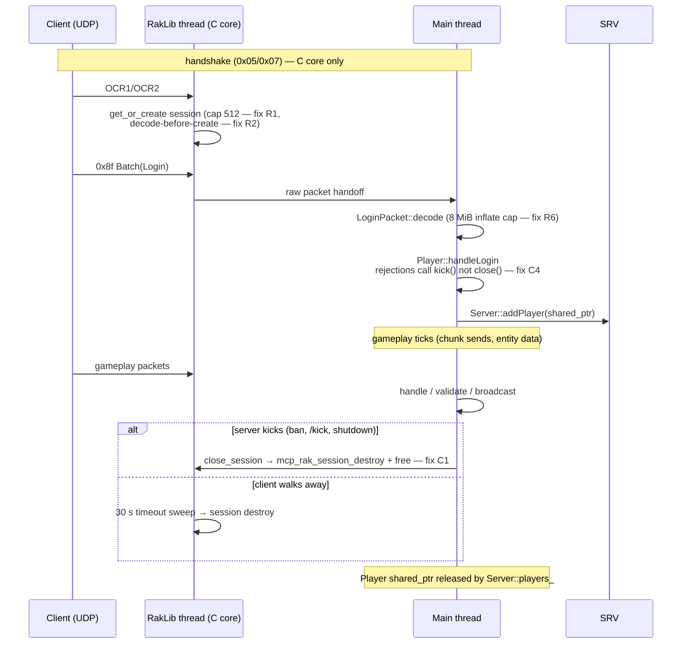

# CurseStone — Ownership & Lifecycle Map

Companion to [`memory-audit.md`](memory-audit.md). Everything here reflects the real code at
`stable` @ `1c2e94d` (class names, member names and files are quoted from the tree, not invented).

Legend for ownership classes used below:
- **owning** — the holder is responsible for destruction (smart pointer, container of
  `unique_ptr`/`shared_ptr`, or the C create/destroy convention).
- **borrowing** — a non-owning pointer/reference; validity is guaranteed by the owner's lifetime
  rules, not by the borrower.
- **C-owned** — `malloc`-allocated, released by the matching `mcp_*_destroy()` / `free()` function.

---

## 1. Process shape

Single process. Six thread classes exist (verified by `std::thread`/`pthread_create` sites):

| Thread | Created by | Role | Stopped by |
|--------|-----------|------|------------|
| Main | OS (`main`) | tick loop, command dispatch, world/entity updates, all packet *handling* | natural return, then ordered teardown |
| RakLib rx | `RakLibInterface` | UDP receive, session bookkeeping, raw packet delivery | `Network::shutdown()` → `iface->shutdown()` (fix L2) |
| AsyncPool workers | `Server::async_pool_` | chunk generation/population | pool drain before world/manager destruction |
| Anvil I/O | `Anvil` provider | async region reads/writes | provider destruction |
| Console reader | `Server::console_reader_` | stdin lines | `CommandReader` stop; commands now dispatch via scheduler (fix L3) |
| Logger worker | C async logger | formatted log emission | `mcp_main_logger_async_destroy()`; respawn-after-destroy blocked by latch (fix L1) |

## 2. Ownership graph (Mermaid)

```mermaid
flowchart TD
    subgraph CXX["C++ layer — shared_ptr ownership"]
        MAIN["main() / CurseStone.cpp"] --> SRV["Server (singleton)"]
        SRV -->|shared_ptr network_| NET["Network"]
        SRV -->|shared_ptr world_ + worlds_| W["World (per world)"]
        SRV -->|vector&lt;shared_ptr&gt; players_| P["Player (per session)"]
        SRV -->|shared_ptr command_map_| CM["CommandMap"]
        SRV -->|shared_ptr async_pool_| AP["AsyncPool (generation workers)"]
        SRV -->|unique_ptr console_reader_| CR["CommandReader"]
        SRV -->|unique_ptr ban lists| BL["BanList ×2"]
        NET -->|vector&lt;unique_ptr&gt; interfaces_| RI["RakLibInterface (owns rx thread)"]
        RI --> CSM["C core: ServerHandler + SessionManager + Sessions"]
        W -->|shared_ptr provider_| AV["Anvil provider (owns I/O thread, FILE* handles)"]
        W -->|shared_ptr generator_| GEN["Generator / Populators"]
        W -->|by value, embedded| CHUNKMGR["ChunkManager"]
        W -->|map&lt;int64_t, unique_ptr&gt;| DI["DroppedItem"]
        W -->|vector&lt;ArrowEntity*&gt; borrowing| ARR["ArrowEntity (owned by entity registry)"]
        W -->|vector&lt;shared_ptr&gt;| TILE["Tile (block entities)"]
        P --> PLUG["Packet queues / sessions"]
    end

    subgraph CCORE["C core — create/destroy convention"]
        CSM -->|malloc/free| SESS["mcp_rak_session_t\n(recovery ring, split slots,\norder holds, send queue)"]
        CSM --> PKT["packet structs (vtable destroy)"]
        CXX2["ChunkManager"] -->|unordered_map&lt;ChunkKey, mcp_chunk_t*&gt;| CH["mcp_chunk_t (mcp_chunk_destroy)"]
        NBT["NBT reader"] -->|mcp_tag_t tree| TAG["mcp_tag (mcp_tag_destroy)"]
    end

    subgraph PLUGIN["Plugin layer"]
        PM["PluginManager"] --> LP["LuaPlugin (per plugin)"]
        LP -->|owning lua_State*| LUA["Lua VM (lua_close)"]
    end

    SRV -->|aggregates| MM["MemoryManager (GC scheduler)"]
    MM -.->|sweeps every world (fix C5)| W
    LOG["AsyncMainLogger (C singleton, worker thread)"]
    EVERY["all subsystems"] -.->|log calls| LOG
```

## 3. Object lifecycles and cleanup responsibilities

### 3.1 Server and singletons

- `Server` is a process-lifetime singleton (`getInstance()`). It *owns* the network, all worlds,
  all players, the command map, the crafting manager, the async pool, the console reader and the
  ban lists (member list verified in `Server.h` lines 378–393).
- Startup order (verified in `src/CurseStone.cpp` + `Server::start()`): logger init → config →
  server construct (network bind, world load, plugin enable) → "Server ready" → tick loop.
- Shutdown order (verified in `Server::runTickLoop()` tail): stop flag → final `Network::tick()`
  → **`Network::shutdown()` (join rx thread — fix L2)** → final forced GC → `saveAll()` → world
  destruction → plugin disable → logger destroy. The signal path only sets `g_stopRequested`
  (async-signal-safe); the tick loop performs the real shutdown. Crash dumps run in a forked
  child (fix P3) so they cannot deadlock on malloc/logger locks.

### 3.2 Player session (highest-churn lifecycle)



Ownership chain: `Server::players_` (owning `shared_ptr`) → `Player` borrows its
`RakLibInterface` and `World` (both owned by `Server`, guaranteed to outlive players because
players are destroyed before worlds in the teardown order). The C session outlives the C++
`Player` only during the disconnect window and is destroyed by exactly one of the two paths above.

### 3.3 Chunk lifecycle

```mermaid
flowchart LR
    REQ["getChunkOrRequestAsync"] -->|pending_| GENQ["AsyncPool worker"]
    GENQ -->|install via setChunk under mtx_| MAP["ChunkManager.chunks_\n(owning map of mcp_chunk_t*)"]
    MAP -->|in view| SEND["serialize → free(buf) — fix C3"]
    MAP -->|GC: no viewers| UNL["unloadDistantChunks"]
    UNL -->|save via provider| ANV["Anvil region file"]
    UNL -->|mcp_chunk_destroy| FREE["freed"]
    MAP -.->|dtor takes mtx_ — fix A6| MAP
    W["World::unloadWorld"] -->|wait pendingCount()==0, else refuse — fix A3| UNL
```

Rules verified in code: every `mcp_chunk_t*` in `chunks_` is destroyed exactly once — either by
`unloadDistantChunks` after a successful save, or by the `ChunkManager` destructor sweep. The
destructor holds `mtx_` so it cannot race a worker installing a chunk. Generation completion
callbacks touch only the manager through the pending-count guard, so a world cannot be destroyed
under them (fix A3).

### 3.4 Entities, dropped items, tiles

- `DroppedItem`: owned by `World::dropped_items_` (`unique_ptr`), erased only by the GC's
  despawn-by-age loop — which now runs for **every** world (fix C5), not just the default world.
- `ArrowEntity`: borrowed by `World::arrows()`; owned by the entity registry. Tasks that outlive
  a tick (lightning removal) must not capture `World*` — the one that did was converted to capture
  the world *name* (fix A5).
- `Tile` (block entities): `shared_ptr`, owned by `World`'s tile map; handed out as
  `shared_ptr` so a tile outlives a pointer handed to a packet handler.

### 3.5 Packets (C structs and C++ objects)

Two families, two conventions:
- C packet structs (`mcp_pkt_*`) use a vtable with `pkt_destroy`; the UNCONNECTED_PONG destroy
  was the only one that leaked its string member (fix C2).
- C++ packets are `shared_ptr<DataPacket>` created per send/broadcast; handlers receive
  `shared_ptr`, so a packet cannot die mid-handler. Decode is exception-guarded centrally in
  `Network::decodePacketById` (fix P1) — a throwing or failing decode drops the packet and logs;
  no half-initialized object escapes.

### 3.6 Plugins / Lua

- `PluginManager` owns `LuaPlugin` instances; each `LuaPlugin` owns exactly one `lua_State*`,
  created on load and closed by `LuaPlugin::disable()` (which also removes listeners and cancels
  tasks). Enable/disable is driven by the main thread (commands are scheduler-dispatched since
  fix L3), so plugin VMs are never touched concurrently by the console thread.
- `MemoryManager` is not an allocator — it is the GC scheduler; since fix C5 it sweeps chunk and
  dropped-item GC across all worlds on one coordinated schedule.

## 4. Non-owning references inventory (as fixed or verified safe)

| Borrowing reference | Held by | Owner | Why safe now |
|---|---|---|---|
| `World*` in `Player` | Player | `Server::worlds_` | players destroyed before worlds |
| `World*` across 20 ticks | LightningRemovalTask | world may unload | **removed** — task stores world name (A5) |
| `Effect*` snapshot | Living::tickEffects | `effects_` shared_ptrs | **snapshot now owning** (A4) |
| `ChunkManager&` in generation callback | AsyncPool task | world's embedded manager | drain-guard in `unloadWorld` (A3) |
| `mcp_chunk_t*` handed to serializers | PlayerChunks/PlayerTick | `chunks_` map | call is synchronous within tick; GC runs on same thread |
| raw `new` sites (PlatformCompat dir object, PerlinNoise arrays) | — | — | verified: each has a matching owner/deleter, no change needed |

## 5. Dangling-reference risks by design (accepted, documented)

- `Server::getInstance()` is reachable from static destructors; the shutdown-order fixes (L1, L2)
  are what make that survivable. New subsystems must follow the same rule: **stop your threads
  before main() leaves its scope**.
- The C core borrows nothing from the C++ layer except the packet delivery callback; the rx
  thread is joined before the C++ objects it calls into are destroyed (L2).
- Task/capture rule going forward: anything scheduled with a delay must capture IDs/names or
  `shared_ptr`, never raw subsystem pointers (the lightning task was the only violator found).

## 6. Cleanup responsibility matrix

| Resource | Creator | Owner | Destructor/releaser | Fixed in this audit |
|---|---|---|---|---|
| `mcp_rak_session_t` + buffers | SessionManager | SessionManager | `mcp_rak_session_destroy` on kick/timeout — kick path was bare `free` (C1) | C1 |
| Pong MOTD string | pong decode | packet struct | `pkt_destroy` (was missing) | C2 |
| Chunk serialize buffer | `mcp_chunk_network_serialize` | caller | caller `free` (was skipped when empty) | C3 |
| RakNet session on login rejection | OCR2 | SessionManager | `kick()` path (was `close()`) | C4 |
| Non-default world chunks/items | World | World | MemoryManager GC (was default-world only) | C5 |
| Generation futures | ChunkManager | ChunkManager | drain guard before world erase | A3 |
| Logger worker/FILE*/mutex | async init | singleton | destroy (no respawn after — L1) | L1 |
| RakLib rx thread | RakLibInterface | RakLibInterface | `Network::shutdown()` before teardown | L2 |
| `lua_State*` | LuaPlugin load | LuaPlugin | `disable()` — verified correct | — |
| Region FILE* | AnvilRegionLoader | Anvil provider | provider destruction — verified correct | — |
